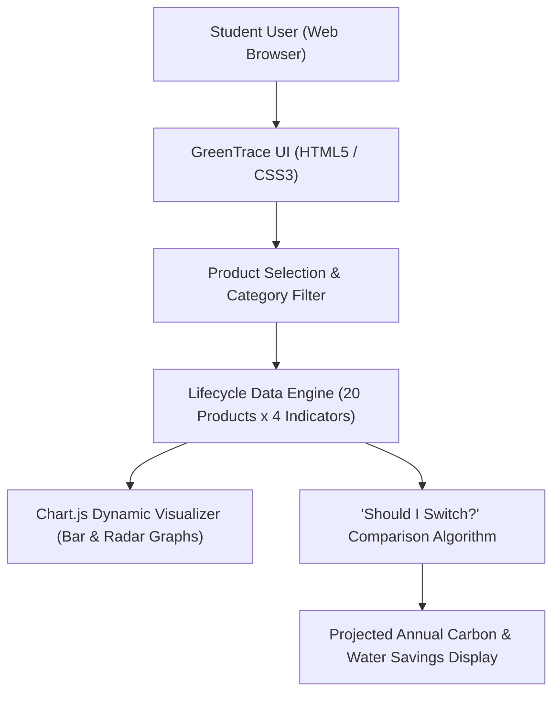

# 🌱 GreenTrace — Indian College Student Carbon Footprint Tracker

<p align="center">
  
</p>

<p align="center">
  An interactive environmental sustainability dashboard developed during the <b>1M1B Green Internship Program</b> to analyze the lifecycle carbon emissions, water footprints, energy consumption, and solid waste of 20 everyday products used by Indian college students.
</p>

<p align="center">
  <a href="https://splendid-fudge-521fc5.netlify.app/">
    
  </a>
  <a href="https://github.com/prakruthidevanga/GreenTrace-Carbon-Footprint-Tracker">
    
  </a>
</p>

<p align="center">
  
  
  
  
</p>

---

## 📌 Table of Contents

- [📖 Project Overview](#-project-overview)
- [🎯 Objectives](#-objectives)
- [✨ Key Features](#-key-features)
- [🌍 The 4 Environmental Dimensions](#-the-4-environmental-dimensions)
- [🏗️ System Architecture & Workflow](#️-system-architecture--workflow)
- [🛠️ Technology Stack](#️-technology-stack)
- [📁 Repository Structure](#-repository-structure)
- [⚙️ Installation and Setup](#️-installation-and-setup)
- [🚀 Live Demo](#-live-demo)
- [🔮 Future Enhancements](#-future-enhancements)
- [🤝 Contributing](#-contributing)
- [👩‍💻 Author & Accreditations](#-author--accreditations)

---

## 📖 Project Overview

**GreenTrace** is a student-centric carbon footprint tracking platform built to bridge the gap between everyday consumption habits and tangible environmental consequences. College students make dozens of daily purchasing decisions—from single-use plastic water bottles and notebooks to fast-food packaging and synthetic clothing—without clear insight into their environmental footprint.

Developed as part of the **1M1B Green Internship** (supported by **Microsoft and EY certifications**), GreenTrace breaks down the environmental footprint of **20 everyday consumer products** commonly used across Indian university campuses into 4 critical lifecycle metrics: carbon dioxide emissions ($kg\text{ }CO_2e$), freshwater consumption ($L$), primary energy draw ($kWh$), and municipal solid waste generation ($g$).

🌱 **Core Mission:** Provide accessible, interactive data visualizations that empower students to make informed, eco-conscious purchasing decisions and embrace circular alternatives.

---

## 🎯 Objectives

- 🌍 **Demystify Lifecycle Impact:** Translate abstract environmental statistics into clear visual metrics for 20 everyday consumer goods.
- 💨 **Quantify Greenhouse Gases:** Measure and compare carbon dioxide equivalent ($CO_2e$) emissions per item lifecycle.
- 💧 **Examine Freshwater Usage:** Quantify embedded agricultural and industrial water consumption across product manufacturing.
- ⚡ **Assess Energy Intensity:** Compare total kilowatt-hour ($kWh$) electricity and thermal draw required for production.
- ♻️ **Address Waste Generation:** Track landfill volume and non-biodegradable waste creation per single-use item.
- 💡 **Empower Sustainable Switches:** Suggest viable eco-friendly alternatives through interactive comparison widgets.

---

## ✨ Key Features

### 🌱 1. Multi-Indicator Comparative Dashboard
Interactive visual charts powered by **Chart.js** displaying real-time comparisons between conventional items and sustainable substitutes across carbon, water, energy, and waste metrics.

### 📦 2. 20+ Everyday Campus Products Evaluated
Comprehensive lifecycle breakdowns covering categories like:
- **Beverages & Food:** Bottled water, disposable coffee cups, packaged snacks.
- **Academic Supplies:** Spiral notebooks, ballpoint pens, paper vs. digital notes.
- **Personal Care & Apparel:** Fast-fashion cotton shirts, synthetic polymers, hygiene packaging.

### 🔄 3. “Should I Switch?” Decision Engine
An interactive recommendation module where students select an item they use regularly and immediately view the projected monthly and annual environmental savings (e.g., switching from disposable PET bottles to stainless steel flasks).

### 📱 4. Responsive Mobile-First Design
Engineered with clean CSS3 and semantic HTML5 to render seamlessly on mobile devices, tablets, and desktop workstations.

---

## 🌍 The 4 Environmental Dimensions

| Indicator | Metric / Unit | Real-World Context & Importance |
| :--- | :---: | :--- |
| **💨 Carbon Dioxide Emissions** | $kg\text{ }CO_2e$ | Measures total greenhouse gas emissions emitted across raw material extraction, processing, and transportation. |
| **💧 Freshwater Consumption** | Liters ($L$) | Evaluates agricultural and industrial process water drawn from aquifers and watersheds during manufacturing. |
| **⚡ Energy Expenditure** | $kWh$ | Quantifies electricity and fuel consumption needed to power refining, manufacturing, and distribution logistics. |
| **♻️ Municipal Solid Waste** | Grams ($g$) | Tracks physical non-biodegradable waste and packaging destined for municipal landfills or marine ecosystems. |

---

## 🏗️ System Architecture & Workflow



---

## 🛠️ Technology Stack

<p align="center">
  
</p>

| Technology | Implementation Role |
| :--- | :--- |
| **HTML5** | Semantic document structure, accessible input forms, and data containers |
| **CSS3** | Responsive Grid and Flexbox layouts, green-accent theme, micro-animations |
| **JavaScript (ES6+)** | Dynamic DOM rendering, footprint calculation algorithms, filter events |
| **Chart.js** | Client-side visual charting (comparative bar graphs, footprint distributions) |
| **Netlify** | Continuous deployment, automated hosting, and production SSL distribution |

---

## 📁 Repository Structure

```text
GreenTrace-Carbon-Footprint-Tracker/
├── GreenTrace.html                  # Core application HTML, styling, and embedded JavaScript
├── GreenTrace_Documentation.pdf     # Formal academic & internship project specification
├── GreenTrace_Final_PPT.pptx        # Executive internship presentation deck
├── README.md                        # Comprehensive project documentation
└── screenshots/                     # Demonstration captures of the live dashboard
```

---

## ⚙️ Installation and Setup

### Prerequisites
- Modern web browser (Chrome, Firefox, Edge, Safari)
- Git installed on your system

### Step 1: Clone the Repository
```bash
git clone https://github.com/prakruthidevanga/GreenTrace-Carbon-Footprint-Tracker.git
cd GreenTrace-Carbon-Footprint-Tracker
```

### Step 2: Run Locally
Since GreenTrace is built as a self-contained web platform with zero build steps required, you can open `GreenTrace.html` directly in any web browser:

```bash
# On Windows (PowerShell)
Start-Process "GreenTrace.html"

# Or using a lightweight local Python server
python -m http.server 8000
```
Then visit `http://localhost:8000` in your web browser.

---

## 🚀 Live Demo

Explore the live, deployed GreenTrace platform:

<p align="center">
  <a href="https://splendid-fudge-521fc5.netlify.app/">
    
  </a>
</p>

---

## 🔮 Future Enhancements

- 📊 **Dynamic Carbon Calculator:** Allow students to log custom daily campus activities (commute, printing, cafeteria meals) for personalized weekly audit reports.
- 🏆 **Gamified Campus Leaderboard:** Peer-to-peer sustainability scoring to foster friendly inter-departmental eco competitions.
- 📱 **Progressive Web App (PWA):** Enable offline caching and home-screen installation on mobile smartphones.
- 🔗 **QR Code Shelf Scanning:** Scan barcode/QR codes on campus store items to retrieve real-time footprint ratings instantly.

---

## 🤝 Contributing

Contributions, feedback, and dataset suggestions are warmly welcomed!

1. Fork the Project (`https://github.com/prakruthidevanga/GreenTrace-Carbon-Footprint-Tracker/fork`)
2. Create your Feature Branch (`git checkout -b feature/AddProductLifecycle`)
3. Commit your Changes (`git commit -m 'feat: add lifecycle data for reusable bamboo cutlery'`)
4. Push to the Branch (`git push origin feature/AddProductLifecycle`)
5. Open a Pull Request

---

## 👩‍💻 Author & Accreditations

**Prakruthi B R**  
*BCA Student specializing in Artificial Intelligence & Machine Learning*  
*Alliance University, Bengaluru (CGPA: 9.60)*  
*GeeksforGeeks Campus Mantri (2026) • 1M1B Green Intern*

- 💻 **GitHub:** [@prakruthidevanga](https://github.com/prakruthidevanga)
- 🔗 **LinkedIn:** [Prakruthi BR](https://linkedin.com/in/prakruthi-br)
- 🌐 **Portfolio:** [prakruthidevanga.github.io](https://prakruthidevanga.github.io/)
- 📬 **Email:** [prakruthibr2006@gmail.com](mailto:prakruthibr2006@gmail.com)

---

<p align="center">
  <b>💚 Empowering conscious student choices, one product lifecycle at a time.</b>
  <br/>
  <i>Track your footprint. Choose circular alternatives. Inspire a sustainable campus.</i>
</p>

<p align="center">
  
</p>
